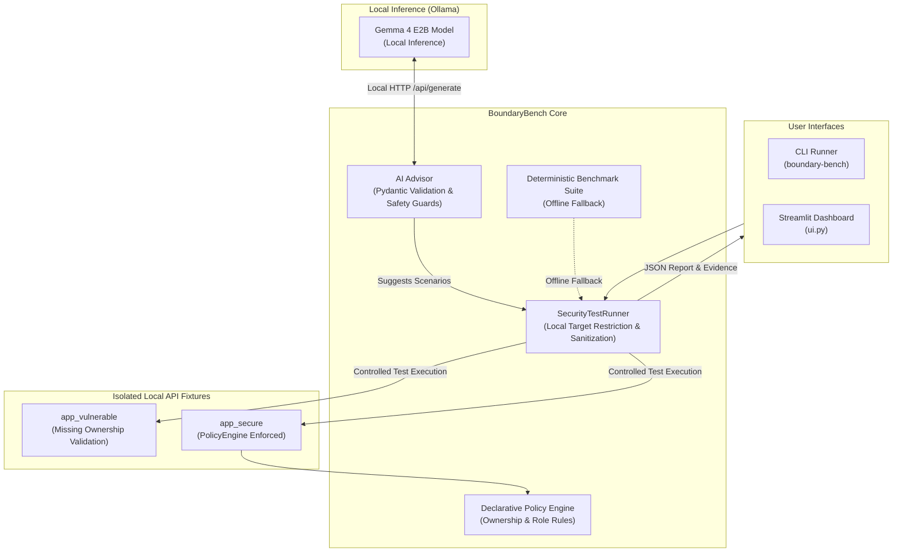

# BoundaryBench

**BoundaryBench** is a local-first, AI-assisted API authorization testing framework. It combines local LLM reasoning (via Gemma 4 E2B on Ollama) to propose structured security test matrices with deterministic Python verification engines that evaluate actual response payloads and observable data exposure.

---

## The Problem: Broken Object Level Authorization (BOLA / IDOR)

Broken Object Level Authorization (BOLA), also known as Insecure Direct Object Reference (IDOR), consistently ranks as the **#1 vulnerability in the OWASP API Security Top 10**. 

BOLA occurs when an API endpoint accepts an object identifier from an authenticated user without verifying whether that user possesses legitimate ownership or permission to access that specific object. While traditional security scanners rely on HTTP status codes alone or generate hundreds of blind fuzzing requests, BoundaryBench deterministically verifies whether sensitive cross-tenant data actually leaked into the client response.

---

## What BoundaryBench Does & Does Not Do

### What it does:
- **Local-First & Private**: Runs completely on localhost using local Gemma 4 E2B via Ollama. Zero network requests to third-party cloud LLMs.
- **Observable Evidence Verification**: Never marks an authorization test as passed or failed based on status codes alone; inspects the returned record body to verify if confidential data was exposed.
- **Isolated Fixtures**: Provides side-by-side vulnerable and secure demo implementations evaluated against the same declarative policy engine.
- **Safety Sandboxing**: Model output is constrained to strict Pydantic schemas. Model suggestions can never execute arbitrary code, shell commands, or query external URLs.
- **Structured Reporting**: Produces reproducible, sanitized JSON evidence reports with token/credential redaction.

### What it does not do:
- Does **not** perform blind network fuzzing or Denial-of-Service testing.
- Does **not** scan remote, external, or unauthorized third-party infrastructure.
- Does **not** treat an LLM's claim as proof of a vulnerability; all findings require verifiable HTTP evidence.
- Does **not** replace a comprehensive manual penetration test or full-scope security audit.

---

## Architecture



---

## Key Features

- **Isolated Vulnerable & Secure Modes**: Demonstrates cross-user authorization bypass and hardened mitigation side by side.
- **Strict Policy Engine**: Declarative `PolicyRule` and `PolicyEngine` schema enforcing object ownership constraints.
- **Deterministic Outcome Classification**: Categorizes every test as `PASS`, `FAIL`, `INCONCLUSIVE`, or `ERROR`.
- **Evidence Sanitization**: Automatically redacts authorization headers, cookies, and tokens from reports.
- **Dual Interfaces**: Full-featured CLI and an interactive Streamlit dashboard.

---

## System Requirements

- **Python**: Version 3.10, 3.11, 3.12, 3.13, 3.14, or 3.15.
- **Operating System**: macOS, Linux, or Windows (WSL recommended).
- **Ollama**: Local Ollama server (version 0.1.30 or newer).
- **Model**: `gemma4:e2b` installed locally in Ollama (optional; deterministic tests run offline without Ollama).

---

## Quickstart

### 1. Environment Setup

```bash
# Clone the repository
git clone https://github.com/<owner>/BoundaryBench.git
cd BoundaryBench

# Create virtual environment
python3 -m venv .venv
source .venv/bin/activate

# Install dependencies and project in editable mode
pip install -r requirements-dev.txt
pip install -e .
```

### 2. Verify Local Ollama & Model (Optional)

If you wish to use AI-suggested test scenarios:

```bash
# Verify Ollama server is running
curl -s http://127.0.0.1:11434/api/tags

# Ensure gemma4:e2b is installed
ollama list
```
*(If `gemma4:e2b` is not installed, BoundaryBench automatically uses the built-in deterministic benchmark suite.)*

---

## Running BoundaryBench

### A. Command-Line Interface (CLI)

Run deterministic authorization tests against both demo modes:
```bash
boundary-bench
```

Run with AI test case suggestions and export the JSON report:
```bash
boundary-bench --ai-suggest --export-report report.json
```

Run against a specific mode:
```bash
boundary-bench --mode vulnerable
boundary-bench --mode secure
```

### B. Interactive Web Dashboard (Streamlit)

Launch the web interface:
```bash
streamlit run boundary_bench/ui.py
```
Open `http://localhost:8501` in your browser to:
1. View live Ollama connection status.
2. Select between Vulnerable and Secure target modes.
3. Propose test cases using Gemma 4 E2B or load the deterministic benchmark.
4. Review validated test parameters before running.
5. Inspect observable evidence and download the JSON report.

---

## Demonstration: Vulnerable vs. Secure

### 1. Intentionally Vulnerable Target (`app_vulnerable`)
- **Requester**: `alice`
- **Target Record**: `rec-bob-202` (owned by `bob`)
- **Outcome**: **FAIL [VULNERABILITY FOUND]**
- **Observed Behavior**: HTTP 200 OK returned. Alice received Bob's private student record, exposing confidential fields: `['gpa', 'disciplinary_notes', 'student_name']`.

### 2. Hardened Secure Target (`app_secure`)
- **Requester**: `alice`
- **Target Record**: `rec-bob-202` (owned by `bob`)
- **Outcome**: **PASS [OK]**
- **Observed Behavior**: HTTP 403 Forbidden returned by `PolicyEngine`. Cross-user access blocked.

---

## Example Report (Illustrative JSON)

```json
{
  "target_base_url": "http://testserver",
  "total_tests": 2,
  "passed": 1,
  "failed": 1,
  "inconclusive": 0,
  "errors": 0,
  "findings_count": 1,
  "records": [
    {
      "test_id": "TEST-01-BOLA_CROSS_USER",
      "test_type": "BOLA_CROSS_USER",
      "endpoint": "/records/rec-bob-202",
      "expected_behavior": "Access rejected with HTTP 403 Forbidden",
      "observed_behavior": "BOLA finding: User 'alice' accessed record 'rec-bob-202' owned by 'bob' (HTTP 200).",
      "outcome": "FAIL",
      "finding_detected": true,
      "evidence": {
        "target_url": "http://testserver/records/rec-bob-202",
        "http_method": "GET",
        "request_headers": {
          "x-user": "alice"
        },
        "response_status_code": 200,
        "protected_data_exposed": true,
        "exposed_fields": ["gpa", "disciplinary_notes", "student_name"]
      }
    }
  ]
}
```

---

## Testing

Run the full offline unit test suite (38 tests, no Ollama needed):
```bash
pytest -v
```

Run with opt-in live Gemma 4 Ollama integration test (requires running Ollama):
```bash
pytest -v --run-integration
```

---

## Troubleshooting

| Issue | Cause | Solution |
|---|---|---|
| `Ollama Server: Offline` in UI | Ollama daemon not started | Run `ollama serve` in a terminal. BoundaryBench will automatically fall back to the deterministic benchmark suite. |
| `Tag gemma4:e2b missing` | Model tag not installed in Ollama | Verify installed tags using `ollama list`. The offline fallback remains fully functional. |
| `Port 8501 in use` | Another Streamlit instance is running | Run on an alternate port: `streamlit run boundary_bench/ui.py --server.port 8502`. |
| `Security policy violation: External host rejected` | Attempting to point runner to external URL | BoundaryBench restricts targets strictly to `testserver`, `localhost`, and `127.0.0.1`. |

---

## Repository Structure

```text
BoundaryBench/
├── .github/
│   ├── ISSUE_TEMPLATE/
│   │   ├── bug_report.md
│   │   └── feature_request.md
│   ├── pull_request_template.md
│   └── workflows/
│       └── ci.yml
├── boundary_bench/
│   ├── __init__.py          # Package initialization & exports
│   ├── advisor.py           # Gemma 4 Ollama connector & safety validators
│   ├── app_secure.py        # Secure FastAPI target (PolicyEngine enforced)
│   ├── app_vulnerable.py    # Vulnerable FastAPI target (BOLA/IDOR fixture)
│   ├── cli.py               # Command-line interface & report exporter
│   ├── database.py          # Synthetic in-memory mock student records
│   ├── models.py            # Pydantic data schemas & evidence models
│   ├── policy.py            # Declarative AuthorizationPolicy & PolicyEngine
│   ├── runner.py            # SecurityTestRunner & target restriction
│   ├── ui.py                # Streamlit web dashboard
│   └── verifier.py          # Single-request verification helper
├── tests/
│   ├── test_boundary.py     # API tests, auth checks, and AI mocks
│   ├── test_policy.py       # PolicyEngine schema & decision unit tests
│   ├── test_runner.py       # SecurityTestRunner & boundary constraint tests
│   └── test_ui.py           # Streamlit headless workflow & export tests
├── conftest.py              # Pytest configuration & integration markers
├── pyproject.toml           # Package metadata, dependencies, and scripts
├── requirements.txt         # Runtime requirements
├── requirements-dev.txt     # Development requirements
├── Makefile                 # Development task shortcuts
├── LICENSE                  # MIT License
├── README.md                # Project documentation
├── CONTRIBUTING.md          # Contribution guidelines
├── CODE_OF_CONDUCT.md       # Contributor Covenant Code of Conduct
├── SECURITY.md              # Vulnerability reporting & scope policy
├── CHANGELOG.md             # Release history
├── .env.example             # Configuration example
└── .gitignore               # Ignored build, cache, and venv files
```

---

## License & Model Terms

- **Source Code**: Licensed under the [MIT License](LICENSE).
- **Gemma Model**: The Gemma family of models is released by Google under the [Gemma Terms of Use](https://ai.google.dev/gemma/terms). Gemma licensing and acceptable use policies are separate from the BoundaryBench codebase license.
